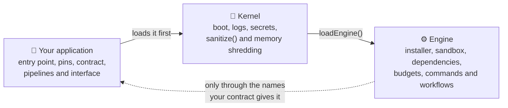

<p align="center">
  
</p>

<h3 align="center">You write the part that makes your application yours.<br>The Engine does the rest.</h3>

<p align="center">
  A security-first engine for self-hosted PHP applications on Linux, on the web & the command line.<br>
  Tools that read your users' files run in a sandbox. Parts are pinned to the exact versions they were tested with.
</p>

<p align="center">
  No cookies &nbsp;&middot;&nbsp; No databases &nbsp;&middot;&nbsp; No third party connections &nbsp;&middot;&nbsp; No analytics &nbsp;&middot;&nbsp; No exceptions
</p>

<p align="center">
  <a href="#-start-a-new-application"><strong>Get Started</strong></a> &middot;
  <a href="README.txt">Build Order</a> &middot;
  <a href="Documentation/ABOUT_ENGINE_CONTRACT.txt">The Contract</a> &middot;
  <a href="Documentation">Documentation</a>
</p>

---

## 🎮 A Game Engine, for PHP Apps

Games don't each reinvent rendering, physics and save files. They ship on an engine. HRProprietary is that idea for self-hosted PHP applications.

Every application carries its own copy of the Engine, built in the way a game ships with its engine. Nothing is installed beside anything else. Two applications on one server share none of their own files, and neither knows the other exists.

The Engine brings the installer, the sandbox, the dependencies, the command line, the logs and the rest of the security plumbing nobody enjoys writing twice. Your application brings what makes it yours.

## 🧱 Three Tiers, One Seam



- **The kernel** boots the installation. It logs, halts, shreds memory, sanitizes input, and keeps the install secret and a visitor's session. It names no application.
- **The Engine** is everything an application of this shape needs: install and repair, `-v` and `-h`, the sandbox, the listener and its managers, dependencies, pipelines, workflows, accounts, configuration and updates.
- **Your application** is its pins, its settings and its logic. Everything the Engine may call in it is named in one file, `Resources/Contract/app-engine-config.php`, and nowhere else.

> [!NOTE]
> The Engine never calls your code except through a name your contract gives it, and the kernel never calls the Engine without asking whether it is loaded. The checkers hold both rules, so nobody has to remember them.

## 🛠️ You Write It, the Engine Handles It

| ✍️ You write | ⚙️ The Engine handles |
| --- | --- |
| An entry point whose boot is nothing but calls | Installing, repairing and updating itself and your application |
| Your pins, one exact version for each part | Your dependencies and its own, with its own build where a distribution's is too old |
| A contract that says who you are and what the Engine may call | A bubblewrap sandbox for every tool, with no network unless it is asked for |
| Your half of `config.php` and your half of the dependency manifest | A configuration utility that adds what a new release brings and keeps every value you set |
| The pipelines you want, written or borrowed | Pinning, ordering and loading them, and refusing any your contract does not name |
| Your interface and your logic | Logs in three tiers, resource budgets, workflows, accounts and email |

## 🚀 The Boot Is Just Calls

This is the shape of an entry point, trimmed from the worked example in `Example/HRConvert2`. The real one checks every return.

```php
$RequiredKernelVersion = 'vX.Y.Z';       // Read from the kernel's file before a line of it runs.
require_once (dirname(__FILE__).'/Resources/Kernel/kernel.php');
verifyCodeIsTrustedByRoot(dirname(__FILE__), basename(__FILE__));
setTimeLimit();
verifyTime();
verifyInstallation();                     // Yours. Your pins, then the kernel verifies the installation.
// Your inputs, each through sanitize(), then verifySession(), verifyTokens() & verifySesHash().
require_once ($InstLoc.'/Resources/Engine/engineConfig.php');
verifyLogs();
list ($EngineActive, $EngineVersion) = loadEngine();
verifyGlobals();                          // Yours.
list ($CommandLineHandled, $UserType, $CommandLineStatus) = runCommandLine(basename(__FILE__));
if (!$CommandLineHandled && $UserType === 'web' && admitWebRequest(basename(__FILE__))) {
  // Your interface & your operations.
  finishWebRequest(); }
```

`-v`, `-h`, `-fp`, `-u`, `--config`, `--setup` and every other command come with the Engine. Your application owns the `--app` namespace.

## 🔌 Pipelines: Borrow Ours or Write Your Own

A pipeline is a plug-in folder that is pinned to a version and sandboxed. It comes in four kinds: conversion, operation, scanner and file. `Resources/Pipelines/` holds every pipeline HRConvert2 ships, ready to adopt one folder at a time:

<p align="center">
  Images &middot; Video &middot; Audio &middot; Subtitles &middot; Streams &middot; Documents &middot; PDFs &middot; Ebooks &middot; OCR &middot; Archives<br>
  3D Models &middot; OpenSCAD &middot; LaTeX &middot; Markup &middot; Structured Data &middot; Email &middot; Drawings &middot; SVG &middot; Tracing &middot; Graphs<br>
  Metadata &middot; Identify &middot; Files &middot; Scanning with ClamAV &amp; ScanCore
</p>

Each folder carries its code, its declarations, a README and the approval record of every tool it runs. A folder your contract does not name is never loaded, so dropping one in does nothing until a person writes its pin.

## ⚡ Start a New Application

1. Copy `Resources/Kernel/` and `Resources/Engine/` into your application, unchanged.
2. Copy `Example/Starter/` and rename it. It is the smallest application the Engine runs: an entry point, a version file and a contract, with one setting and one command. `Example/HRConvert2/` is the worked example of a whole application. Read it, and copy none of it whole.
3. Write your contract in `Resources/Contract/`. It holds `app-engine-config.php`, your half of `config-template.php` and your half of `depends.php`. You also write a function that models your settings.
4. Adopt the pipelines you want. [README.txt](README.txt) gives the seven steps.
5. Bring it up, from a tree only root can change:

```bash
sudo php yourApp.php --config --repair            # Write config.php from both halves of the template.
sudo php yourApp.php --setup --install-complete   # Install the application & every dependency.
sudo php yourApp.php -v                           # Say what works, what does not & why.
```

Something drifted? `sudo php yourApp.php -fp` puts the folders, the permissions and the web server's setup back.

## 🔍 Quality You Can Run

Three checkers ship with the Engine. They read your contract, so they check your application unchanged. Run them from your application's root:

```bash
python3 -I Documentation/Build/hrconvert2-check.py     # The code. Authoritative.
bash Documentation/Build/hrconvert2-check.sh           # A second opinion, in shell & awk.
python3 -I Documentation/Build/hrconvert2-doccheck.py  # The documents.
```

Both code checkers must agree, and a check is proven to catch its fault before it is trusted. [ABOUT_QUALITY_CONTROL.txt](Documentation/ABOUT_QUALITY_CONTROL.txt) says what each check is for and which fault it was written after.

## 🧭 The Rules It Lives By

- 🧱 **The sandbox is the wall.** Filters and sanitizers are conveniences. Any tool that parses a hostile file is assumed exploitable, so it runs where it can do no harm.
- 📌 **Pins are supposed to hurt.** Parts from different releases do not mix. A mismatched part is refused before it loads, not after.
- 🪂 **Fall back before failing.** Try what was asked, warn, try the default, warn again, and only then stop.
- 🔊 **Say what happened.** Activity, warnings and numbered errors, with every number documented in `ERROR_DESCRIPTIONS.txt`.
- 🧹 **Shred it, do not just forget it.** Sensitive values are overwritten as soon as they have been used.

## 🏗️ Built on HRProprietary

<table>
  <tr>
    <td align="center" width="50%">
      <a href="https://github.com/zelon88/HRConvert2"></a><br>
      <sub>Convert almost anything, on your own server. Nothing ever leaves it.</sub>
    </td>
    <td align="center" width="50%">
      <a href="https://github.com/zelon88/HRProtect"></a><br>
      <sub>The scanner that tells you what it did not check.</sub>
    </td>
  </tr>
</table>

## 🧾 Requirements

- Debian or Ubuntu, on anything from a Raspberry Pi Model B+ up.
- PHP 8.0 or newer.
- Apache 2.4 with mod_php. PHP-FPM and nginx are not supported.
- Bubblewrap for the sandbox, and curl.
- systemd for resource budgets, services and timers.

`sudo php yourApp.php -v` lists everything an installation has and everything it lacks.

## 📚 Read Next

| Document | What it covers |
| --- | --- |
| [`README.txt`](README.txt) | What this kit holds & the order to build in. |
| [`ABOUT_ENGINE_CONTRACT.txt`](Documentation/ABOUT_ENGINE_CONTRACT.txt) | The seam between the Engine & your application. The authority. |
| [`ABOUT_COMPONENTS.txt`](Documentation/ABOUT_COMPONENTS.txt) | Every component, its pin & the order it loads in. |
| [`ABOUT_MANAGERS.txt`](Documentation/ABOUT_MANAGERS.txt) | The listener & its managers. |
| [`ABOUT_PIPELINE_COMPONENTS.txt`](Documentation/ABOUT_PIPELINE_COMPONENTS.txt) | What a pipeline declares & how it is loaded. |
| [`CREATING_CONVERSION_PIPELINES.txt`](Documentation/CREATING_CONVERSION_PIPELINES.txt) | Writing a pipeline of your own. |
| [`ABOUT_COMMAND_LINE_ARGUMENTS.txt`](Documentation/ABOUT_COMMAND_LINE_ARGUMENTS.txt) | Every command the Engine answers. |
| [`CODING_CONVENTIONS.txt`](Documentation/CODING_CONVENTIONS.txt) | The conventions the code is written to. |
| [`ERROR_DESCRIPTIONS.txt`](Documentation/ERROR_DESCRIPTIONS.txt) | Every numbered error & warning, its cause & its fix. |
| [`ENGINE_MIGRATION_STATUS.txt`](Documentation/ENGINE_MIGRATION_STATUS.txt) | How the Engine came out of HRConvert2, step by step, with the proof of each. |

## 📜 License

GNU GPLv3. Copyright Justin Grimes, [www.github.com/zelon88](https://www.github.com/zelon88).

<p align="center"><sub>&lt;3 Open-Source</sub></p>
